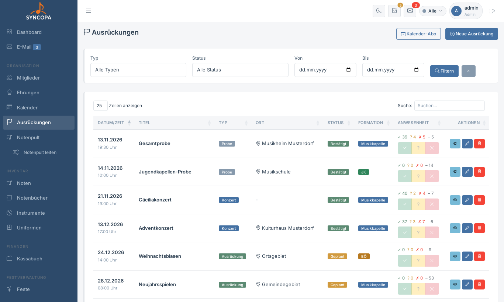
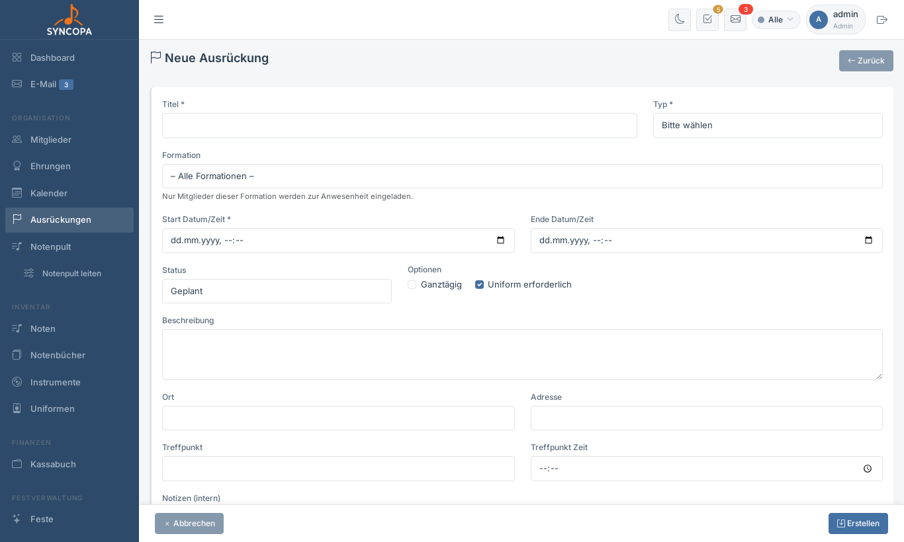
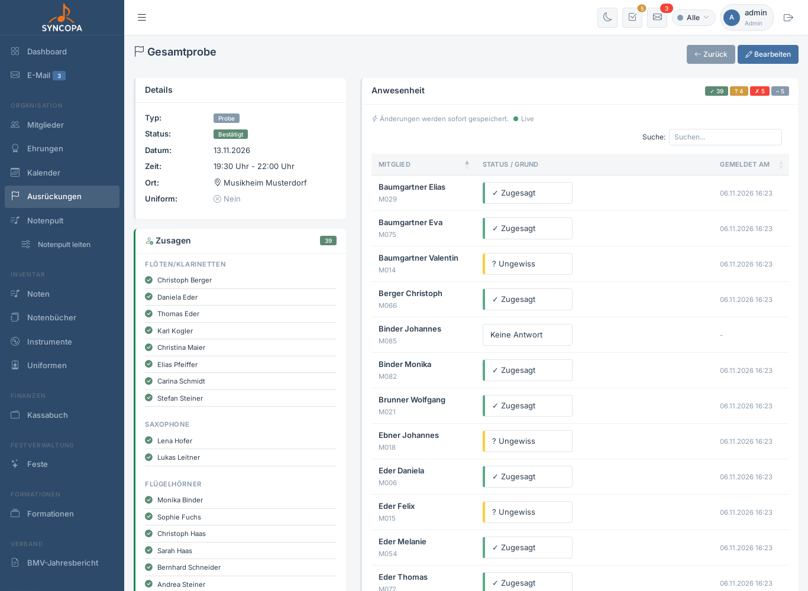
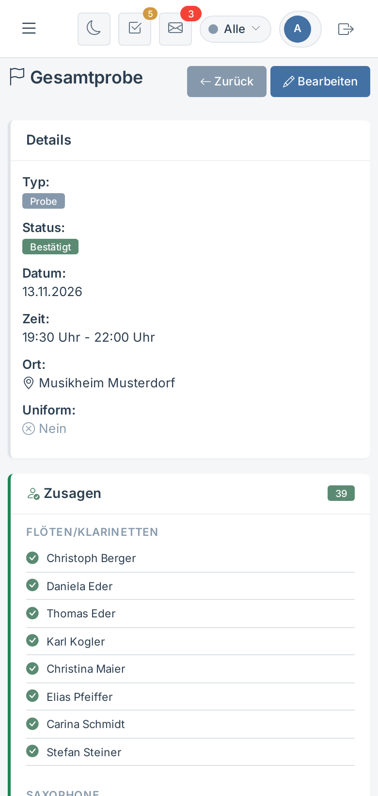
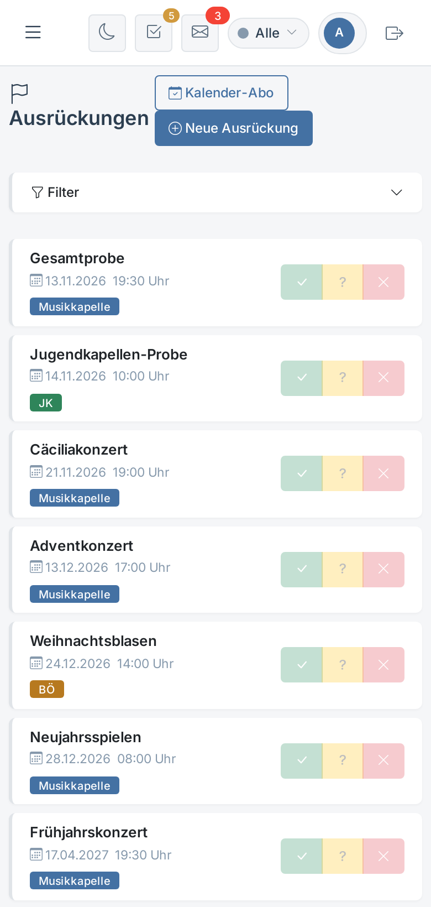
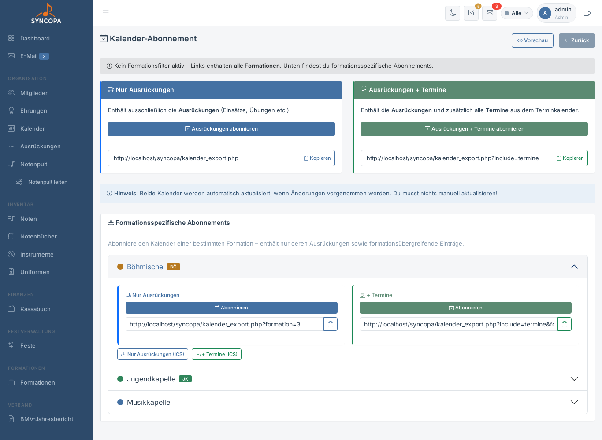

# Ausrückungen

**Datei:** `ausrueckungen.php`  
**Berechtigung:** `ausrueckungen – lesen`

Unter Ausrückungen werden alle öffentlichen und internen Auftritte des Vereins geplant und verwaltet.

---

## Übersicht

Die Übersicht zeigt alle Ausrückungen mit:

| Spalte | Beschreibung |
|---|---|
| Datum & Uhrzeit | Termin der Ausrückung |
| Titel | Name / Titel der Ausrückung |
| Typ | Typ der Veranstaltung |
| Ort | Veranstaltungsort |
| Status | `geplant` · `bestätigt` · `abgesagt` |
| Formation | Zeigt (falls vergeben) das farbige Kürzel der zugehörigen Formation |
| Anwesenheit | Anzahl zugesagt (✓) / ungewiss (?) / abgesagt (✗) / keine Antwort (– grau), direkt daneben eigene An-/Abmelde-Buttons |
| Aktionen | Detail · Bearbeiten · Löschen |

### Filter

- **Typen:** Filter nach den Typen der Ausrückung (Probe, Konzert, Ausrückung, Fest, Wertung, Sonstiges)
- **Zeitraum:** Von/Bis-Datum eingrenzen
- **Status:** Nach Planungsstatus filtern

Auf dem Handy ist der Filter eingeklappt und lässt sich über die Zeile „Filter“ aufklappen. Eine Plakette zeigt, wie viele Filter aktiv sind.

> 💡 **Tipp:** Ist oben in der Kopfzeile eine Formation aktiv, werden hier automatisch nur die Ausrückungen **dieser Formation** angezeigt (plus formationsübergreifende Ausrückungen ohne Formationszuordnung). Mehr dazu: → [Formationen](formationen.md)

---

## Ausrückung anlegen

**Datei:** `ausrueckung_bearbeiten.php`  
**Berechtigung:** `ausrueckungen – schreiben`

1. Klicke auf **+ Neue Ausrückung**
2. Fülle das Formular aus
3. Klicke auf **Speichern**

### Formularfelder

| Feld | Pflicht | Beschreibung |
|---|---|---|
| Titel | ✅ | Name der Ausrückung |
| Start Datum | ✅ | Startdatum der Veranstaltung |
| Ende Datum | - | Enddatum der Veranstaltung |
| Uhrzeit | – | Beginn der Ausrückung |
| Treffpunkt-Uhrzeit | – | Vorankunft für Aufbau etc. |
| Ort | – | Veranstaltungsort |
| Adresse | – | Detaillierte Adresse |
| Status | ✅ | geplant / bestätigt / abgesagt |
| Formation | – | Nur sichtbar, wenn Formationen angelegt sind. Legt fest, welche Mitglieder zur Anwesenheit eingeladen werden (siehe unten). Leer = für alle Formationen |
| Beschreibung | – | Weitere Informationen |
| Uniform | – | Kleiderordnung für diesen Termin |
| Treffpunkt / Treffpunkt-Uhrzeit | – | Vorankunft für Aufbau etc. |
| Notizen | – | Interne Anmerkungen, nicht öffentlich sichtbar |
| BMV-Anlass | – | In welcher Zeile die Ausrückung im [BMV-Jahresbericht](bmv-jahresbericht.md) zählt. Leer = aus dem Typ |
| Probenart | – | Nur bei Proben: Vollprobe oder Teilprobe (für den Jahresbericht) |

> 💡 **Tipp:** Ist oben in der Kopfzeile eine Formation aktiv, wird sie beim Anlegen automatisch als Formation der neuen Ausrückung vorausgewählt.

### Automatische Anwesenheitsliste

Beim **Speichern einer neuen Ausrückung** legt Syncopa automatisch für jedes betroffene Mitglied einen Anwesenheits-Eintrag mit Status „keine Antwort" an:

- Ist der Ausrückung eine **Formation** zugeordnet, werden nur die **aktiven Mitglieder dieser Formation** eingetragen.
- Ist **keine Formation** zugeordnet, werden **alle aktiven Mitglieder** des Vereins eingetragen.

Dadurch muss niemand die Anmeldeliste manuell befüllen – jedes betroffene Mitglied kann sofort auf der Übersichtsseite zu- oder absagen.

Die Anmeldelisten **kommender** Ausrückungen werden bei jedem Aufruf der Ausrückungsliste und der Detailseite mit den aktuellen Mitgliedern abgeglichen: Neue oder neu zugeordnete Mitglieder (z. B. nach dem BMV-Abgleich der Mitgliedsarten oder einer Formationszuordnung) kommen als „keine Antwort“ dazu. Wechselt die Formation einer Ausrückung, fallen nur unberührte Einträge weg – wer schon geantwortet hat, bleibt stehen. Vergangene Ausrückungen bleiben unverändert.

> 💡 Als aktiv zählt die **Mitgliedsart** (Stammdaten → Mitgliedsarten, „zählt als aktiv“). Mitglieder ohne laufende Mitgliedsart gelten als ausgetreten und erscheinen nicht in der Anmeldeliste.

---

## Detailansicht einer Ausrückung

**Datei:** `ausrueckung_detail.php`

Die Detailseite zeigt:

- Alle Termindaten auf einen Blick
- **Anmeldeliste** mit Status jedes Mitglieds:
  - ✅ Zugesagt
  - ❌ Abgesagt  
  - ❓ Noch keine Antwort
- **Grund** der Mitglieder (z.B. Begründung bei Absage)
- Zusammenfassung: Wie viele haben zugesagt / abgesagt mit Registeraufteilung
- Zähler über der Anmeldeliste: ✓ zugesagt · ? ungewiss · ✗ abgesagt · – keine Antwort (grau)

### Live-Aktualisierung

Die Anmeldeliste, die Zähler und die Karten „Zusagen“ / „Absagen“ aktualisieren sich alle 15 Sekunden von selbst („● Live“ mit Uhrzeit über der Liste). So sieht z. B. der Kapellmeister sofort, wer zu- oder absagt. Geänderte Zeilen und neue Namen leuchten kurz auf. Ist der Browser-Tab im Hintergrund, wird nicht abgefragt.

### Anmeldeliste bearbeiten

**Berechtigung:** `ausrueckungen – schreiben`

- Der Status jedes Mitglieds kann direkt in der Liste geändert werden – **die Änderung wird sofort gespeichert** („✓ Gespeichert“ unter der Zeile)
- Ein dezenter Farbstreifen links am Status zeigt die Wahl: grün zugesagt, gelb ungewiss, rot abgesagt
- Das Feld **Grund** erscheint nur bei einer Absage oder wenn schon ein Grund eingetragen ist; es wird kurz nach dem Tippen gespeichert
- Am Handy stehen Status und Grund untereinander, „Gemeldet am“ steht unter dem Namen

---

## An- und Abmeldung

Mitglieder können sich selbst zu Ausrückungen an- oder abmelden:

1. Ausrückungen auf der Startseite
2. Auf ✅ oder ❓ oder ❌ klicken
3. Optional bei ❌: Grund hinterlassen
4. Status wird sofort gespeichert
5. Optimiert für Mobilgeräte (Smartphone)

Administratoren können den Status für beliebige Mitglieder auf der Ausrückung Detailseite setzen.

---

## Kalender abonnieren (iCal)

Mit dem iCal-Export können alle Vereinstermine in externe Kalender-Apps eingebunden werden:

### Export Auswahl

Es kann zwischen 1. "Ausrückungen abonnieren" und 2. "Ausrückungen + Termine" abonnieren gewählt werden

1. hier werden nur die Ausrückungen abonniert
2. hier werden auch die Termine aboniert (Sitzungen, sonstige Termine)

### Google Calendar

1. Navigiere zu **Kalender → Abonnement**
2. Kopiere die **iCal-URL**
3. Öffne Google Calendar
4. Klicke auf **„+"** neben „Andere Kalender"
5. Wähle **„Per URL"** und füge die URL ein
6. Klicke **Kalender hinzufügen**

### Apple Kalender (iOS / macOS)

1. Kopiere die iCal-URL aus Syncopa
2. Öffne auf dem iPhone: **Einstellungen → Kalender → Account hinzufügen → Andere → Kalenderabo hinzufügen**
3. Füge die URL ein → **Weiter** → **Sichern**

### Microsoft Outlook

1. Öffne Outlook
2. Klicke auf **Kalender hinzufügen → Aus dem Internet**
3. Füge die iCal-URL ein → **OK**

> ℹ️ **Hinweis:** Eine direkte Synchronisation mit **Google Calendar** (automatisches Anlegen/Ändern von Google-Kalender-Einträgen durch Syncopa selbst) ist im System als Option vorbereitet, aber standardmäßig deaktiviert und für den produktiven Einsatz noch nicht fertiggestellt. Für den Kalenderabgleich mit Google, Apple oder Outlook wird aktuell der iCal-Abo-Link oben verwendet – das funktioniert zuverlässig in alle Richtungen.

---

## Kalendervorschau

**Datei:** `kalender_vorschau.php`

Die Vorschau zeigt eine Liste aller zukünftigen Ausrückungen, die im iCal-Export enthalten sind – praktisch, um vor dem Abonnieren zu prüfen, ob alle erwarteten Termine dabei sind.