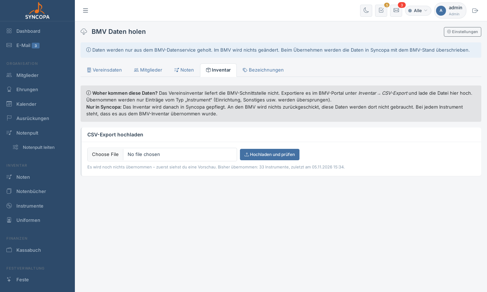
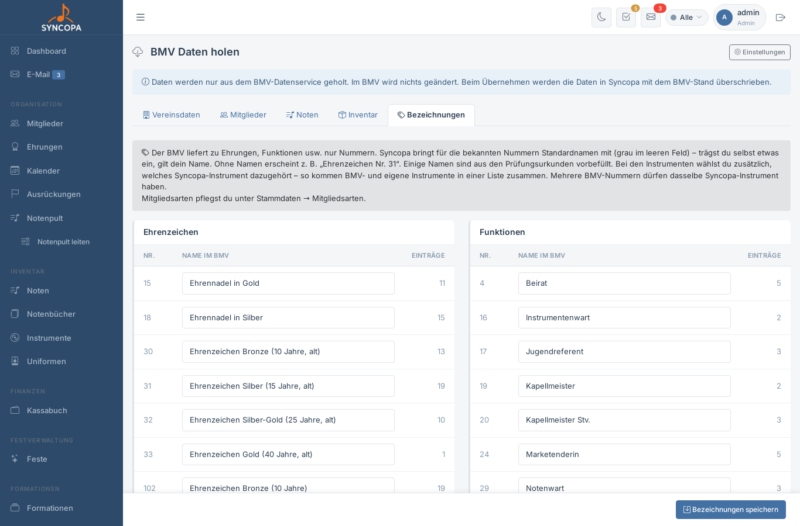

# BMV Daten holen

**Datei:** `bmv_daten.php` · **Menü:** Verband → BMV Online → BMV Daten holen · **Berechtigung:** Modul „BMV Online“ in der Rechte-Matrix (Administratoren immer)

Syncopa holt Vereinsdaten, Mitglieder (mit Ehrungen, Funktionen, Instrumenten, Prüfungen und Mitgliedsarten), Noten und das Inventar aus dem Blasmusikverband (BMV). **Im BMV wird dabei nichts geändert** – Syncopa liest nur.

Jeder Bereich zeigt zuerst eine **Vorschau**, was sich ändern würde. Übernommen wird erst mit dem Knopf **Übernehmen**.

| Recht „BMV Online“ | Was geht |
|---|---|
| Lesen | Vorschau aller Bereiche ansehen |
| Schreiben | Daten übernehmen, Inventar-Datei hochladen, Bezeichnungen speichern |

> 💡 Der Menüpunkt erscheint nur, wenn unter [Einstellungen → BMV](einstellungen.md#bmv-anbindung) die Anbindung aktiv ist und die Zugangsdaten eingetragen sind. Ohne Anbindung gibt es unter **Verband** nur den [BMV-Jahresbericht](bmv-jahresbericht.md).

---

## Vereinsdaten

Gegenüberstellung der Vereinsdaten (Name, Adresse, Kontakt …): links der Stand in Syncopa, rechts im BMV. Abweichende Felder sind markiert. **Übernehmen** schreibt den BMV-Stand in Syncopa.

## Mitglieder

Die Vorschau ist in drei Gruppen geteilt:

| Gruppe | Was beim Übernehmen passiert |
|---|---|
| **Neu im BMV** | Die Musiker werden in Syncopa angelegt, mit dem Status „überprüfen“ |
| **Geändert im BMV** | Die genannten Felder werden mit dem BMV-Stand überschrieben |
| **Nur in Syncopa** | Die Mitglieder werden nur markiert, **nicht gelöscht** |

Mitgeholt werden außerdem **Funktionen, Ehrungen, Instrumente, Prüfungen und Mitgliedsarten**. Einträge, die im BMV gelöscht wurden, werden auch in Syncopa entfernt. Eigene Einträge aus Syncopa bleiben erhalten; gibt es denselben Eintrag auch im BMV, wird er damit verknüpft. Einträge aus dem BMV sind beim Mitglied gesperrt und lassen sich nur im BMV ändern.

Danach bestimmt die **laufende Mitgliedsart**, ob ein Mitglied als aktiv zählt (siehe [Mitgliedsarten](stammdaten.md#mitgliedsarten)). Die Ehrungen erscheinen unter [Ehrungen](ehrungen.md).

## Noten

Holt das Notenarchiv des Vereins aus dem BMV. Die Vorschau zeigt jedes Stück mit BMV-Nummer, Titel, Komponist/Bearbeiter, Musikart, ob Notenmaterial vorhanden ist, und **was passiert** (neu, zusammengeführt, ergänzt, unverändert).

- Stücke **ohne Notenmaterial** werden standardmäßig übersprungen; per Häkchen lassen sie sich mitnehmen.
- Die Noten werden danach **in Syncopa gepflegt** – an den BMV wird nichts zurückgeschickt.
- Holst du später erneut, kommen nur neue Stücke dazu. Bei vorhandenen werden nur leere Felder ergänzt, deine Änderungen bleiben.
- Führt der BMV ein Stück mehrfach, ist es gekennzeichnet und wird mehrfach übernommen.

## Inventar

Das Vereinsinventar liefert die BMV-Schnittstelle nicht. Deshalb:

1. Im BMV-Portal unter **Inventar → CSV-Export** die Datei herunterladen
2. Hier hochladen (**Hochladen und prüfen**, höchstens 5 MB) – noch wird nichts übernommen
3. **Instrumentart zuordnen:** zu jeder Bezeichnung aus dem BMV die passende Instrumentart in Syncopa. Vorschläge sind eingetragen, die Wahl wird für den nächsten Import gemerkt.
4. **Instrumente prüfen:** Inventarnummer, Bezeichnung, Fabrikat/Seriennummer, Kauf, Zuteilung und was passiert
5. **Übernehmen**

Übernommen werden nur Einträge vom Typ „Instrument“. Werte, die in Syncopa schon eingetragen sind, bleiben erhalten – aus dem BMV werden nur leere Felder ergänzt. Die Zuteilung an Mitglieder läuft über das Mitglied im BMV bzw. Name und Geburtsdatum; ohne passendes Mitglied wird das Instrument ohne Zuteilung übernommen.

## Bezeichnungen

Der BMV liefert zu Ehrungen, Funktionen, Instrumenten und Prüfungen nur **Nummern**. Syncopa bringt für bekannte Nummern Standardnamen mit (grau im leeren Feld). Trägst du selbst einen Namen ein, gilt deiner. Ohne Namen erscheint z. B. „Ehrenzeichen Nr. 31“.

- Bei Instrumenten wählst du zusätzlich das passende **Syncopa-Instrument**.
- **Nummer hinzufügen:** für Nummern, die im Verein noch niemand hat (z. B. ein Ehrenzeichen, das man selbst eintragen möchte). Die Nummer steht im BMV-Portal.
- Mitgliedsarten haben einen eigenen Katalog unter [Stammdaten → Mitgliedsarten](stammdaten.md#mitgliedsarten).

---

## Hinweis auf neue Daten

Syncopa prüft in dem unter Einstellungen eingestellten Abstand, ob es im BMV Neues gibt. Gibt es Neues, erscheint in den Einstellungen ein Hinweis, und am Menüpunkt **BMV Online** zeigt eine gelbe Zahl, wie viele Änderungen warten.
