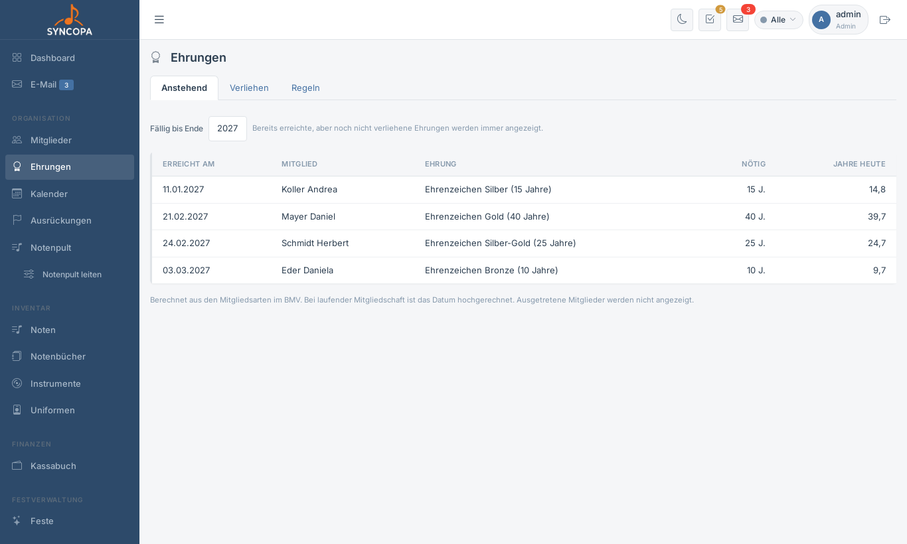
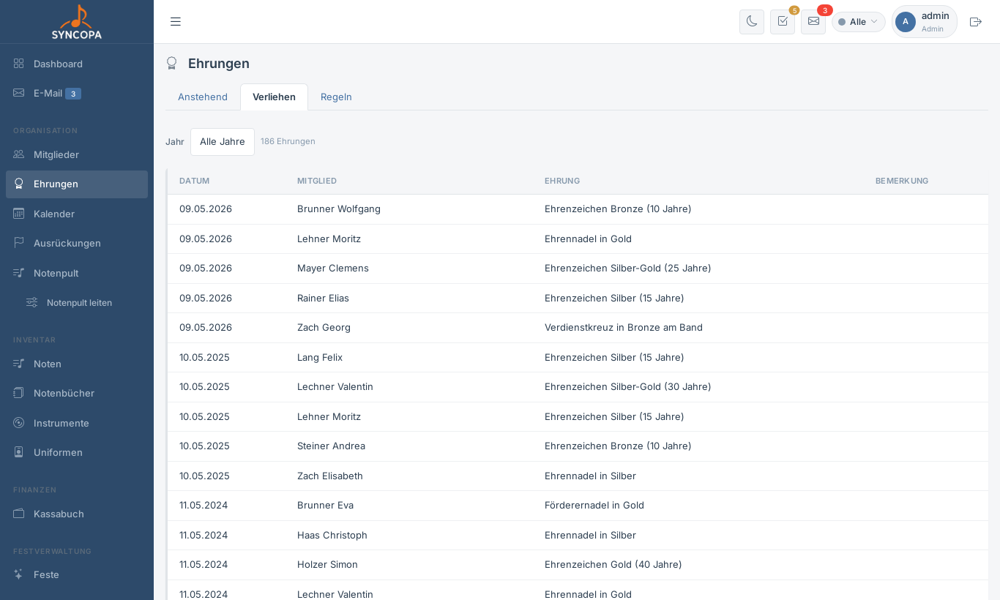
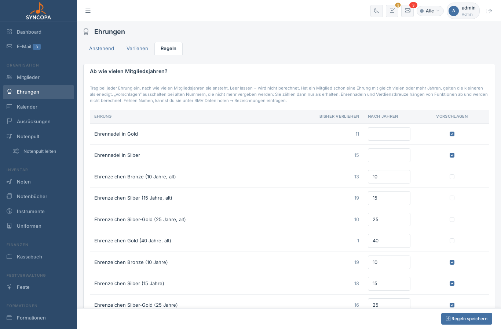

# Ehrungen

**Datei:** `ehrungen.php` · **Menü:** Organisation → Ehrungen · **Berechtigung:** `mitglieder – lesen` (Reiter **Regeln** nur für Administratoren)

Syncopa zeigt, welche Ehrungen im Verein schon verliehen wurden und welche als Nächstes anstehen. Die verliehenen Ehrungen kommen aus dem BMV, die anstehenden rechnet Syncopa aus den Mitgliedsjahren aus.

---

## Anstehend

Liste aller Mitglieder, die bis Ende des gewählten Jahres eine Ehrung erreichen.

| Spalte | Bedeutung |
|---|---|
| Erreicht am | Tag, an dem die nötigen Mitgliedsjahre erreicht sind. Bei laufender Mitgliedschaft ist das Datum hochgerechnet. Ein rotes **fällig** heißt: schon erreicht, aber noch nicht verliehen. |
| Mitglied | Link zur Detailseite des Mitglieds |
| Ehrung | Name der Ehrung (z. B. Ehrenzeichen in Bronze) |
| Nötig | So viele Mitgliedsjahre braucht die Ehrung |
| Jahre heute | Mitgliedsjahre des Mitglieds bis heute |

- Oben wählst du, **bis zu welchem Jahr** die Liste reicht (dieses Jahr bis fünf Jahre voraus). Bereits erreichte, aber noch nicht verliehene Ehrungen stehen immer in der Liste.
- Hat ein Mitglied mehrere Stufen auf einmal erreicht, erscheint nur die höchste – niedrigere werden nicht nachverliehen.
- Ausgetretene Mitglieder und Gäste (z. B. Gastmusiker/innen) erscheinen nicht.

Damit die Liste etwas zeigt, müssen unter **Regeln** die Jahre eingetragen sein.

## Verliehen

Alle Ehrungen, die Mitglieder laut BMV erhalten haben, mit Datum und Bemerkung. Oben lässt sich nach Jahr filtern. Ausgetretene Mitglieder sind mit **ausgetreten** gekennzeichnet.

Die Ehrungen kommen aus dem BMV über [BMV Daten holen → Mitglieder](bmv-daten.md#mitglieder). Eigene Ehrungen lassen sich beim Mitglied im Reiter **Laufbahn → Ehrungen** eintragen.

## Regeln (nur Administratoren)

### Ab wie vielen Mitgliedsjahren?

Für jede Ehrung, die im Verein vorkommt, trägst du ein, nach wie vielen Mitgliedsjahren sie ansteht. Leer gelassen wird sie nicht berechnet.

- **Bisher verliehen:** wie oft es die Ehrung im Verein schon gibt
- **Vorschlagen:** ausschalten bei alten Nummern, die nicht mehr vergeben werden. Sie zählen dann nur noch als „erhalten“.
- Hat ein Mitglied schon eine Ehrung mit gleich vielen oder mehr Jahren, gelten die kleineren als erledigt.
- Ehrennadeln und Verdienstkreuze hängen von Funktionen ab und werden nicht berechnet.
- Fehlen Namen von Ehrungen, trägst du sie unter [BMV Daten holen → Bezeichnungen](bmv-daten.md#bezeichnungen) ein.

### Was zählt als Mitgliedsjahr?

Mitgliedsjahre werden aus den Zeiträumen der [Mitgliedsarten](stammdaten.md#mitgliedsarten) berechnet. Hier wählst du, welche Mitgliedsarten zählen (z. B. nur „aktives Mitglied“). Ist nichts gewählt, zählen alle. Überschneiden sich Zeiträume, werden sie nur einmal gezählt.

---

## Beim Mitglied

Auf der Detailseite eines Mitglieds zeigt die Karte **Laufbahn → Ehrungen** die Mitgliedsjahre, die erhaltenen und die anstehenden Ehrungen. Ein rotes **!** am Reiter weist auf eine fällige Ehrung hin.
