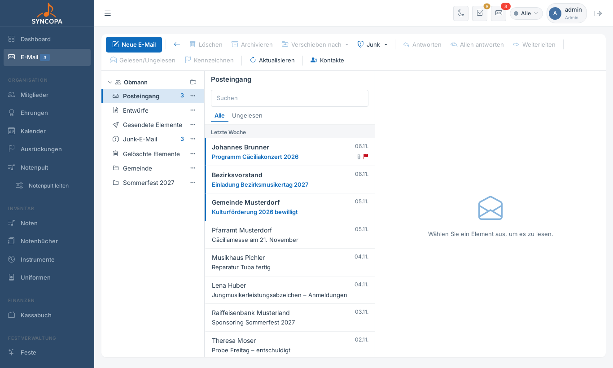

# E-Mail

Syncopa hat ein eigenes E-Mail-Programm im Stil von Outlook. Damit liest und schreibt man die Vereinspost direkt in Syncopa, z. B. für **obmann@verein.at** oder **kapellmeister@verein.at**. Das Programm funktioniert mit jedem Postfach, das IMAP und SMTP anbietet.

**Dateien:** `mail.php` (E-Mail), `konto.php` (Mein Konto), `mail_konten.php` (Funktions-Postfächer)

---

## Postfächer

Es gibt zwei Arten von Postfächern:

| Art | Wer richtet es ein? | Wer sieht es? |
|---|---|---|
| **Persönliches Postfach** | jeder Benutzer selbst unter **Mein Konto** | nur dieser Benutzer |
| **Funktions-Postfach** (z. B. obmann@…) | Admin unter **Administration → Funktions-Postfächer** | alle Benutzer mit einer der freigegebenen Rollen |

Wechselt das Amt, muss niemand Passwörter weitergeben. Der Admin ändert nur die Rolle, und der neue Obmann sieht das Postfach sofort.

### Postfach einrichten

1. **Mein Konto** öffnen (Klick auf den eigenen Namen links unten) → **Postfach hinzufügen**
2. Anbieter wählen (z. B. Gmail, Outlook, GMX, A1, World4You), dann sind Server und Ports schon ausgefüllt. Bei einem eigenen Server die Angaben des Providers eintragen.
3. E-Mail-Adresse und Passwort eingeben. Bei Gmail und Outlook braucht es ein **App-Passwort**.
4. **Verbindung testen** und speichern

Unter **Mein Konto** kann jeder Benutzer außerdem seine E-Mail-Adresse und sein Passwort ändern.

> 🔒 Die Postfach-Passwörter werden verschlüsselt gespeichert. Der Schlüssel liegt in der Datei `config.mailkey.php`. Diese Datei gehört unbedingt zur Datensicherung. Ohne sie müssen alle Postfach-Passwörter neu eingetragen werden.

---

## Lesen und schreiben



- **Ordnerleiste links:** alle Postfächer mit ihren Ordnern und der Zahl ungelesener Nachrichten
- **Liste in der Mitte:** nach Datum gruppiert (Heute, Gestern, Diese Woche …), mit Suche und Filter „Ungelesen“
- **Lesebereich rechts:** Bilder aus dem Internet werden zum Schutz der Privatsphäre erst auf Klick geladen
- **Befehlsleiste:** Neue E-Mail, Löschen (auch mit der Entf-Taste), Archivieren, Verschieben nach, Junk, Antworten, Allen antworten, Weiterleiten, Gelesen/Ungelesen, Kennzeichnen

Beim Schreiben schlägt das **Adressbuch** Mitglieder und Gruppen vor, z. B. „Alle aktiven Mitglieder“, eine Formation oder ein Register. Gruppen werden immer als **Bcc** verschickt, damit niemand die Adressen der anderen sieht. Anhänge sind bis zusammen 20 MB möglich. Jedes Postfach kann eine eigene Signatur haben.

### Große Dateien

- Anhänge dürfen zusammen höchstens **20 MB** groß sein, denn mehr nehmen viele Mailserver nicht an.
- **Größere Dateien** (über 10 MB je Datei oder über 20 MB zusammen, bis 2 GB) verschickt Syncopa automatisch als **Download-Link**. Am Anhang steht dann „Download-Link“. Beim Senden wird die Datei in Stücken hochgeladen (mit Fortschrittsanzeige), und in die Mail kommt ein Kasten „Dateien zum Herunterladen“.
- Unten im Schreibfenster wählt man, wie lange der Link gilt: 7, 14, 30 oder 90 Tage. Danach löscht Syncopa die Datei automatisch.
- Der Empfänger braucht keine Anmeldung. Der Link enthält einen langen Zufallsschlüssel.
- Unter **Mein Konto → Meine Download-Links** sieht man, wie oft eine Datei heruntergeladen wurde, kann den Link kopieren oder vorzeitig löschen.
- **Voraussetzung:** Syncopa muss von außen erreichbar sein. Ein Administrator trägt die öffentliche Adresse unter **E-Mail → Funktions-Postfächer → Große Dateien als Download-Link** ein (z. B. `https://verein.at/syncopa`). Solange dort eine interne Adresse steht, verschickt Syncopa keine Links, die draußen nicht funktionieren würden.

Unter **„Gesendete speichern in“** wählt man, in welchem Ordner die gesendete Nachricht abgelegt wird. Standard ist „Gesendete Elemente“.

### Benachrichtigung

Neben **E-Mail** im Menü und oben in der Kopfzeile steht die Zahl der ungelesenen Nachrichten in allen eigenen Postfächern. Sie wird alle zwei Minuten aktualisiert.

---

## Kontakte

**Datei:** `mail_kontakte.php` (Knopf **Kontakte** in der E-Mail-Befehlsleiste)

Hier werden Adressen gespeichert, die keine Mitglieder sind, z. B. Gemeinde, Pfarre, Musikhaus, Presse oder Nachbarvereine.

- Jeder Kontakt hat Name oder Organisation, Funktion, E-Mail, Telefon, Adresse und Notizen.
- Der Haken **„Für alle mit E-Mail-Zugang sichtbar“** macht einen Kontakt **gemeinsam**: Alle, die ein Postfach in Syncopa nutzen, sehen ihn. Ohne Haken bleibt er **privat** und nur der Ersteller sieht ihn.
- Ändern und löschen kann einen Kontakt nur, wer ihn angelegt hat, oder ein Administrator. Die anderen sehen gemeinsame Kontakte nur zum Lesen.
- Beim Schreiben schlägt das Adressbuch Kontakte vor (Hinweis „Kontakt“ bzw. „Kontakt (privat)“).
- Beim Lesen einer Mail speichert **„+ Kontakt“** neben dem Absender diesen gleich als Kontakt.
- **E-Mail schreiben** in der Kontaktliste öffnet eine neue Nachricht an den Kontakt.
- Mails von Kontakten kommen nie in den Junk-Ordner.

---

## Ordner

Ordner werden direkt auf dem Mailserver angelegt und sind damit auch im Handy oder in Outlook sichtbar.

- **Neuer Ordner:** über das Ordner-Symbol neben dem Postfach oder **Rechtsklick → Neuer Unterordner**
- **Umbenennen / Löschen:** per Rechtsklick oder über „⋯“ am Ordner. Standardordner wie Posteingang oder Papierkorb sind geschützt, und nur leere Ordner lassen sich löschen.
- **Verschieben:** über **Verschieben nach** oder Nachrichten mit der Maus auf einen Ordner ziehen. Im Menü gibt es auch „Neuer Ordner …“.

---

## Junk-E-Mail (Spamfilter)

Gerade öffentliche Adressen bekommen viel Werbung und Betrugsmails. Der Spamfilter sortiert sie für jedes Postfach einzeln in den Ordner **Junk-E-Mail** aus. Gelöscht wird dabei nichts.

Der Filter prüft neue Nachrichten im Posteingang in dieser Reihenfolge:

1. **Sichere Absender** kommen immer durch. Dazu zählen automatisch die Mitglieder, Benutzer und Kontakte aus Syncopa, die eigenen Postfächer und alle, denen man schon geschrieben hat. Dazu kommt die eigene Liste.
2. **Blockierte Absender** landen immer im Junk. Das geht auch für ganze Domains wie `@werbung.com`.
3. Hat der **Mailserver** die Nachricht als Spam gekennzeichnet, kommt sie in den Junk.
4. Der **Lernfilter** lernt aus Ihren Entscheidungen. Er entscheidet mit, sobald er je 10 Junk- und erwünschte Beispiele kennt.

### Bedienung

Über **Junk ▾** in der Befehlsleiste:

| Befehl | Wirkung |
|---|---|
| **Junk-E-Mail** | in den Junk-Ordner verschieben, der Filter lernt daraus |
| **Absender blockieren** / **Domain blockieren** | zusätzlich auf die Liste der blockierten Absender |
| **Kein Junk** (im Junk-Ordner) | zurück in den Posteingang, der Absender gilt künftig als sicher |
| **Junk-E-Mail-Optionen …** | Filter ein/aus, Lernstand, sichere und blockierte Absender, Liste der aussortierten Mails mit Grund |

Öffnet man eine Nachricht im Junk-Ordner, zeigt ein gelber Hinweis, **warum** sie aussortiert wurde, z. B. „Absender blockiert“.

### Wann wird geprüft?

- sobald jemand den Posteingang öffnet
- alle 5 Minuten im Hintergrund, wenn der Cronjob eingerichtet ist (siehe [Einrichtung → Cronjob für den Spamfilter](einrichtung.md#_39-cronjob-für-den-spamfilter-optional))

```bash
*/5 * * * * www-data /usr/bin/php /var/www/html/syncopa/cron/mail_spamfilter.php >/dev/null 2>&1
```

Der Cronjob lernt außerdem laufend dazu und löscht abgelaufene Download-Links. Gelesene Nachrichten, die im Posteingang bleiben, gelten als erwünscht.

---

## Technisches

- Für IMAP und SMTP braucht es keine PHP-imap-Erweiterung und keine Fremdbibliothek. Nötig sind nur `openssl` und `sodium`, beide sind seit PHP 7.2 dabei.
- PHP muss Uploads bis 25 MB annehmen (`upload_max_filesize = 25M`, `post_max_size = 32M`, siehe [Einrichtung](einrichtung.md)). Sonst scheitern größere Anhänge und Belege.
- Erlaubte Ports: IMAP 143/993, SMTP 25/465/587/2525. Interne Serveradressen dürfen nur Admins eintragen.
- HTML-Mails werden bereinigt und abgeschottet angezeigt, Skripte werden nie ausgeführt.
- Tabellen: siehe [Datenbankstruktur](datenbank.md#e-mail)
