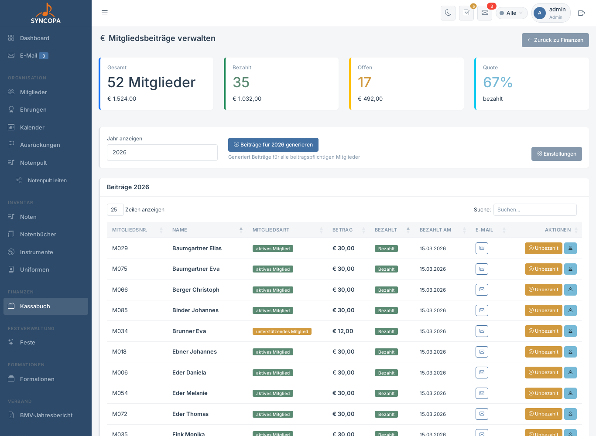

# Kassabuch

**Datei:** `finanzen.php`
**Berechtigung:** `finanzen – lesen`

Das Kassabuch erfasst alle Einnahmen und Ausgaben des Vereins, getrennt nach Konten (Handkassa, Girokonto, Sparbuch …), mit Kategorien und Belegen. Daraus entstehen die Unterlagen, die der Kassier für die Kassaprüfung und die Jahreshauptversammlung braucht.

> ⚖️ Rechtlicher Rahmen: Kleine Vereine brauchen nach § 21 Vereinsgesetz 2002 eine **Einnahmen-Ausgaben-Rechnung samt Vermögensübersicht** (innerhalb von 5 Monaten nach Jahresende). Zwei **Rechnungsprüfer** prüfen innerhalb von 4 Monaten und berichten dem Vorstand. Die Statuten können mehr verlangen.

---

## Übersicht

Oben stehen alle **Konten** mit ihrem Stand am Jahresende (bzw. heute) und dem Anfangsbestand am 1.1., dazu das **Jahresergebnis**. Ein Klick auf ein Konto zeigt nur dessen Buchungen, mit Anfangsbestand, **laufendem Saldo** und Endbestand – wie ein Kontoauszug.

Drei Reiter gliedern die Seite:

- **Buchungen** – alle Buchungen des Jahres, filterbar nach Konto, Art und Kategorie
- **Mitgliedsbeiträge** – Beitragsstatus je Mitglied
- **Berichte & Abschluss** – Ausdrucke, Jahresabschluss, Kassasturz, Voranschlag und CSV-Export

Das Jahr wird oben rechts gewählt. Abgeschlossene Jahre sind mit einem Schloss gekennzeichnet.

---

## Konten & Kategorien

**Datei:** `finanz_konten.php` · **Berechtigung:** `finanzen – schreiben`

- **Konten:** beliebig viele, z. B. Handkassa, Girokonto, Sparbuch oder eine eigene Jugendkassa. Bei der Einrichtung sind **Handkassa** und **Girokonto** angelegt. Ein Konto kann einer Formation zugeordnet werden; nicht mehr benutzte Konten werden auf „inaktiv“ gesetzt.
- **Anfangsbestand:** nur im ersten Jahr eintragen (Kassastand bzw. Kontoauszug am 1.1.). In den Folgejahren rechnet Syncopa den Anfangsbestand aus dem Vorjahr weiter. Ein eingetragener Wert hat Vorrang.
- **Kategorien:** Vorlage mit den üblichen Posten eines Musikvereins (Mitgliedsbeiträge, Subventionen, Konzerte, Feste, Noten, Instrumente, Trachten, Jugendarbeit, Verbandsbeiträge/AKM, Versicherungen …). Kategorien lassen sich ergänzen, umbenennen, sortieren und für Einnahmen, Ausgaben oder beides festlegen. Bei jeder Kategorie lässt sich einstellen, in welche Zeile des [BMV-Jahresberichts](bmv-jahresbericht.md) sie zählt.
- **Reihenfolge:** Konten und Kategorien lassen sich am Griff links (⋮⋮) per Drag & Drop verschieben; die Reihenfolge wird sofort gespeichert. Das erste aktive Konto ist bei neuen Buchungen vorausgewählt (bei Barzahlung die erste Kassa).

---

## Buchung erfassen

**Datei:** `transaktion_bearbeiten.php` · **Berechtigung:** `finanzen – schreiben`

| Feld | Beschreibung |
|---|---|
| Art | **Einnahme**, **Ausgabe** oder **Umbuchung** (Geld zwischen zwei eigenen Konten, z. B. Bargeld aufs Girokonto einzahlen – zählt nicht als Einnahme oder Ausgabe) |
| Datum, Betrag | Pflichtfelder |
| Belegnummer | Wird automatisch vergeben (Standard `2026-001`, je Jahr neu). Der Nummernkreis ist unter **Stammdaten → Nummernkreise** einstellbar. |
| Konto | bzw. „Von Konto“ und „Nach Konto“ bei Umbuchungen |
| Kategorie | aus der Liste, passend zur Art |
| Buchungstext | z. B. „Rechnung Musikhaus – Reparatur Tuba“ |
| Beleg | Rechnung oder Quittung als PDF oder Foto (max. 10 MB). Am Handy kann direkt fotografiert werden. Belege sind nur für angemeldete Benutzer mit Finanz-Leserecht abrufbar. |

**„Speichern und nächste“** öffnet gleich das Formular für die nächste Buchung, praktisch beim Nachtragen vieler Belege.

---

## Berichte zum Ausdrucken

Unter **Berichte & Abschluss** öffnet jeder Bericht eine druckfertige A4-Seite mit Vereinskopf („Drucken / als PDF speichern“).

| Bericht | Wofür | Inhalt |
|---|---|---|
| **Kassabuch (Journal)** | Kassaprüfung | alle Buchungen je Konto mit Belegnummer, laufendem Saldo, Anfangs- und Endbestand |
| **Einnahmen-Ausgaben-Rechnung** | Jahreshauptversammlung, Prüfer | Summen je Kategorie mit Vorjahresvergleich und Jahresergebnis |
| **Vermögensübersicht** | Jahreshauptversammlung, Prüfer | Kontostände 1.1. und 31.12., Abstimmung mit dem Jahresergebnis, offene Beiträge, Inventarwert der Instrumente, Feld für Verbindlichkeiten |
| **Kassaprüfungsbericht** | Rechnungsprüfer | Prüfer, Datum, geprüfte Bestände, Feststellungen, Antrag auf Entlastung, Unterschriften |
| **Kassabericht** | Jahreshauptversammlung | Einnahmen, Ausgaben und Ergebnis mit Vorjahr, Balkengrafik „Woher kam das Geld / wofür wurde es ausgegeben“, Kontostände |
| **Belegliste** | Kassaprüfung | alle Belege nach Nummer, fehlende Nummern, Buchungen ohne Belegdatei, Spalte zum Abhaken |
| **Beitragsliste** | Kassier, Obmann | bezahlte und offene Mitgliedsbeiträge |
| **Voranschlag / Soll-Ist** | Jahreshauptversammlung | Budget je Kategorie neben den Ist-Werten von Vorjahr und Jahr |

Zusätzlich lassen sich alle Buchungen eines Jahres als **CSV** für Excel oder den Steuerberater herunterladen.

---

## Kassasturz

**Datei:** `finanz_kassasturz.php`

Bargeld nach Scheinen und Münzen zählen. Syncopa rechnet die Summe, vergleicht sie mit dem Kassastand laut Kassabuch und zeigt die Differenz. Gespeicherte Zählungen lassen sich als Protokoll mit Unterschriftsfeldern drucken. Für die Zählung auf Papier gibt es ein leeres Zählblatt.

---

## Voranschlag

**Datei:** `finanz_budget.php`

Budget je Kategorie für ein Jahr planen, z. B. für den Beschluss in der Jahreshauptversammlung. Die Ist-Werte des Vorjahres lassen sich als Ausgangspunkt übernehmen. Im laufenden Jahr zeigt die Seite die Abweichung zwischen Plan und Ist.

---

## Jahresabschluss

**Datei:** `finanz_abschluss.php`

1. **Zahlen prüfen** – Einnahmen, Ausgaben, Kontostände und Belege kontrollieren, Berichte drucken
2. **Kassaprüfung** – Rechnungsprüfer, Prüfdatum und Feststellungen eintragen, Prüfbericht drucken
3. **Abschließen** – danach sind Buchungen, Anfangsbestände und Belege dieses Jahres gesperrt. Nur ein Administrator kann ein Jahr wieder öffnen.

---

## Verbindung mit anderen Bereichen

- **Mitgliedsbeiträge** werden beim Markieren als bezahlt automatisch gebucht (siehe unten).
- **Feste:** In der Fest-Abrechnung übernimmt „Ins Kassabuch übernehmen“ die tatsächlichen Einnahmen und Ausgaben als je eine Buchung (Kategorie „Feste und Veranstaltungen“). Bestellte Einkäufe und offene Honorare zählen erst, wenn sie bezahlt sind. Erneutes Übernehmen aktualisiert die Buchungen.
- **Formationen:** Buchungen erhalten die Formation ihres Kontos. In der Buchungsliste sieht man die Buchungen der aktiven Formation und alle vereinsweiten Buchungen. Berichte gelten immer für den Gesamtverein.

---

## Mitgliedsbeiträge verwalten

**Datei:** `beitraege_verwalten.php`  
**Berechtigung:** `finanzen – schreiben`

Mitgliedsbeiträge werden **jahresweise generiert** und danach einzeln als bezahlt bzw. unbezahlt markiert. Sie sind **nicht** formationsspezifisch – Beiträge gehören immer zum Gesamtverein.

### Beiträge für ein Jahr generieren

1. Navigiere zu **Finanzen → Beiträge verwalten**
2. Wähle oben das gewünschte **Jahr**
3. Klicke auf **„Beiträge für [Jahr] generieren"**
4. Bestätige die Abfrage

Syncopa legt daraufhin für jedes beitragspflichtige Mitglied automatisch einen offenen Beitrag in der passgenauen Höhe an. Bereits vorhandene Beiträge für dieses Jahr werden dabei übersprungen, es entstehen also keine doppelten Einträge.

> 💡 **Tipp:** Welche Mitgliedstypen (aktiv, passiv, Ehrenmitglied, ausgetreten) überhaupt Beiträge zahlen und wie hoch der Jahresbeitrag ist, wird in den **Einstellungen** festgelegt. Für den Status „aktiv" und „passiv" können unterschiedliche Beträge hinterlegt werden.

### Beitrag als bezahlt markieren

Für jedes Mitglied zeigt die Liste Mitgliedsnummer, Name, Status, Betrag und aktuellen Zahlungsstatus:

1. Finde das Mitglied in der Liste (offene Beiträge stehen standardmäßig oben)
2. Klicke auf **„Bezahlt"**, sobald der Beitrag eingelangt ist – das Datum wird automatisch auf heute gesetzt
3. Falls ein Beitrag versehentlich als bezahlt markiert wurde, kann er über **„Unbezahlt"** wieder zurückgesetzt werden

> 💰 **Automatisch im Kassabuch:** Wird ein Beitrag als bezahlt markiert, bucht Syncopa ihn als Einnahme (Kategorie „Mitgliedsbeiträge“): bei Barzahlung in die Kassa, sonst aufs erste Bankkonto. Beim Zurücksetzen auf „Unbezahlt“ wird die Buchung wieder entfernt.

Über das Brief-Symbol lässt sich direkt eine E-Mail an das Mitglied öffnen, über das Personen-Symbol gelangt man zur Mitgliederdetailseite.

Vier Statistik-Karten zeigen zusätzlich Gesamtanzahl, bezahlte und offene Beiträge sowie die Zahlungsquote in Prozent.

---

## Berechtigungen im Überblick

| Aktion | Benötigte Berechtigung |
|---|---|
| Kassabuch, Berichte und Belege ansehen | `finanzen – lesen` |
| Buchungen, Konten, Kategorien, Voranschlag, Kassasturz, Beiträge, Kassaprüfung und Abschluss | `finanzen – schreiben` |
| Buchungen löschen | `finanzen – loeschen` |
| Abgeschlossenes Jahr wieder öffnen | Administrator |
