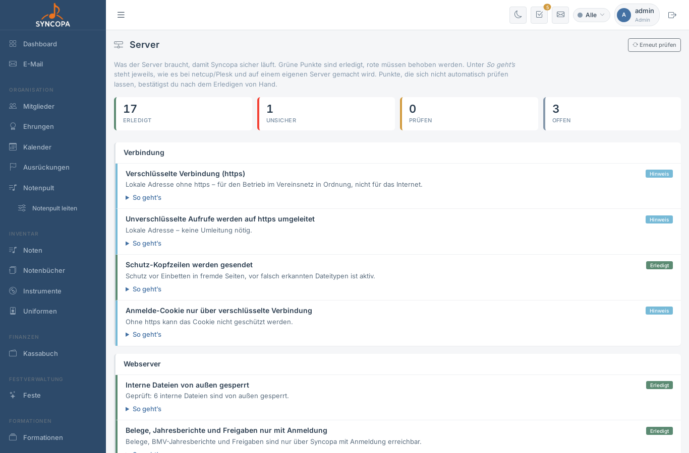

# Server

**Datei:** `server.php` · **Menü:** System → Server · **Berechtigung:** nur Administratoren

Die Seite zeigt, was der Server braucht, damit Syncopa sicher läuft – mit Ampel und Anleitung zu jedem Punkt. Sie ist die Checkliste für alle, die Syncopa betreuen.

---

## Ampel

| Anzeige | Bedeutung |
|---|---|
| **Erledigt** (grün) | Alles in Ordnung |
| **Unsicher** (rot) | Muss behoben werden – die Anleitung ist bereits aufgeklappt |
| **Prüfen** (gelb) | Funktioniert, sollte aber verbessert werden |
| **Hinweis** (blau) | Zur Information, z. B. bei einer lokalen Installation ohne https |
| **Offen** (grau) | Lässt sich nicht automatisch prüfen – nach dem Erledigen **Als erledigt bestätigen** |

Oben zeigt eine Zusammenfassung, wie viele Punkte erledigt, unsicher, zu prüfen und offen sind. **Erneut prüfen** lädt die Seite neu.

Unter **So geht’s** steht bei jedem Punkt, wie er bei **netcup/Plesk** und auf einem **eigenen Server** erledigt wird.

## Was geprüft wird

| Bereich | Punkte |
|---|---|
| Verbindung | https, Umleitung von http auf https, Schutz-Kopfzeilen, Anmelde-Cookie nur verschlüsselt |
| Webserver | interne Dateien gesperrt, Belege/Jahresberichte/Freigaben nur mit Anmeldung, keine Ordnerlisten, `.htaccess` vorhanden |
| PHP & Dateien | PHP-Version, Fehlermeldungen ausgeblendet, kein Programmcode im Upload-Ordner, Rechte der Zugangsdaten-Datei, Installations-Assistent gesperrt |
| Zugänge | keine Standardpasswörter, Administratoren im Überblick, Sperre nach Fehlversuchen, BMV-Passwort verschlüsselt |
| Syncopa | aktuelle Version |
| Organisatorisch | Datensicherung, zweiter Faktor für Hosting/Cloudflare/GitHub, starke persönliche Passwörter (von Hand bestätigen) |

Die Punkte unter **Webserver** und die Schutz-Kopfzeilen prüft **dein Browser**: Er ruft die gesperrten Adressen genauso auf wie ein Außenstehender. Das Ergebnis zeigt also, was von außen wirklich erreichbar ist – auch mit Cloudflare oder einem anderen Dienst davor.

---

## Eingebaute Schutzmaßnahmen

Diese Maßnahmen laufen automatisch, ohne Einstellung:

- **Sperre nach Fehlversuchen:** Nach 5 falschen Passwörtern für einen Benutzernamen (oder 20 von derselben Adresse) ist die Anmeldung 15 Minuten gesperrt. Während der Sperre wird das Passwort gar nicht erst geprüft.
- **Prüfzeichen gegen untergeschobene Aktionen:** Jedes Formular und jede Hintergrund-Anfrage trägt ein geheimes Prüfzeichen der Sitzung. Fremde Seiten oder präparierte Links können deshalb nichts in Syncopa ändern oder löschen. Löschen geht nur noch über die Schaltfläche mit Rückfrage, nicht über einen einfachen Link.
- **Sitzung:** Nach der Anmeldung bekommt die Sitzung eine neue Kennung. Das Cookie ist nur für Syncopa selbst gültig und wird über https nur verschlüsselt übertragen.
- **Schutz-Kopfzeilen:** Syncopa lässt sich nicht in fremde Seiten einbetten; über https wird der Browser angewiesen, nur noch verschlüsselt zu verbinden.
- **Passwortregeln:** mindestens 8 Zeichen, bekannte Standardpasswörter werden abgelehnt.
- **Persönliche Kalender-Links** mit geheimem Schlüssel (siehe [Kalender](kalender.md#kalender-abonnieren-ical)).
- **Verschlüsselte Zugangsdaten:** Postfach- und BMV-Passwörter liegen verschlüsselt in der Datenbank. Den Schlüssel enthält `config.mailkey.php` – unbedingt mitsichern.
- **Schutzdatei `.htaccess`:** siehe [Installation 3.10](einrichtung.md#_310-schutz-durch-die-htaccess).
