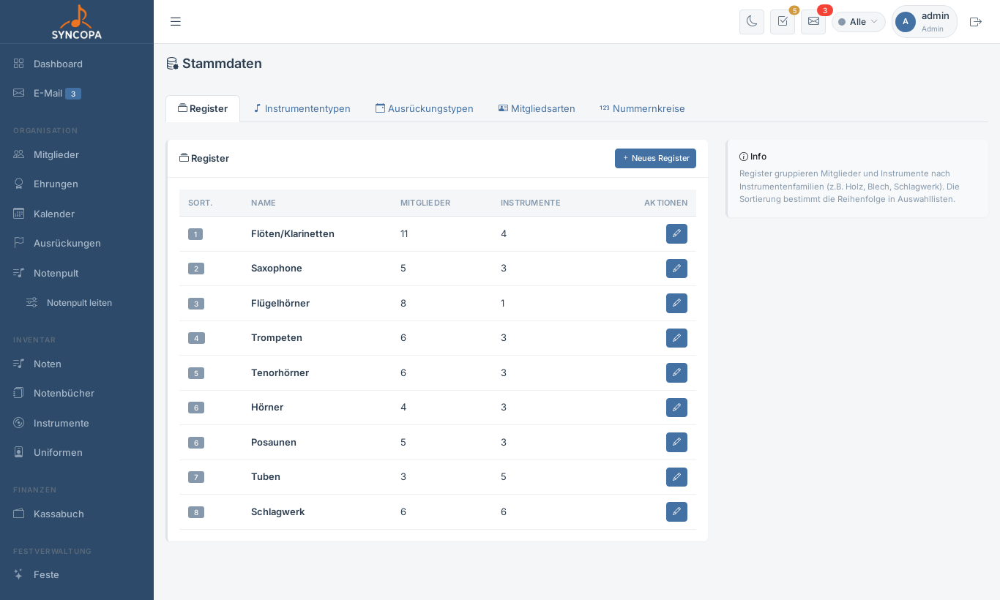
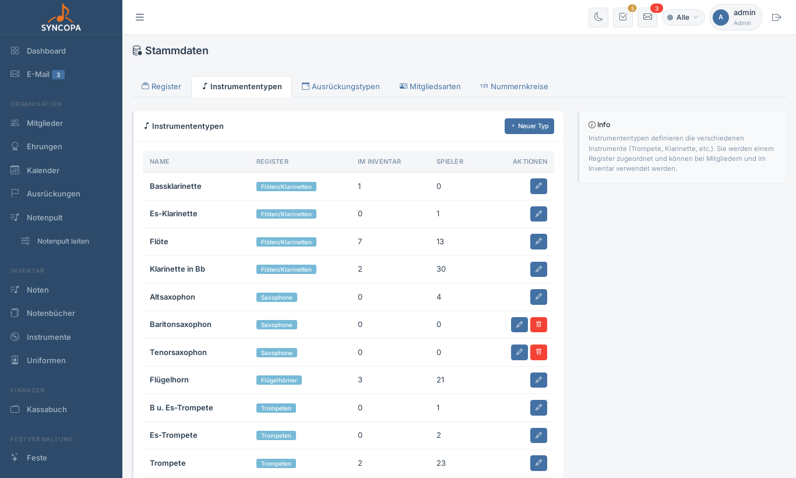
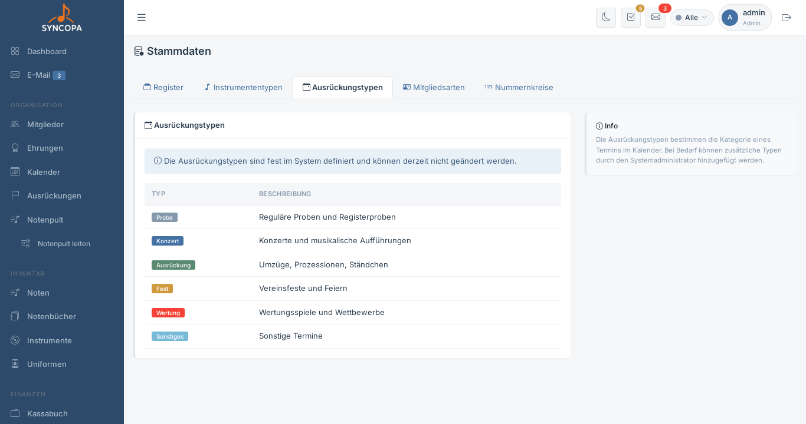
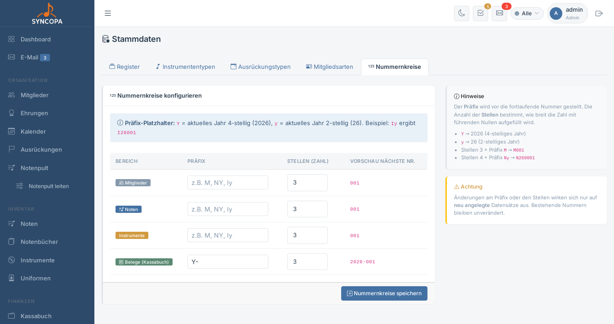
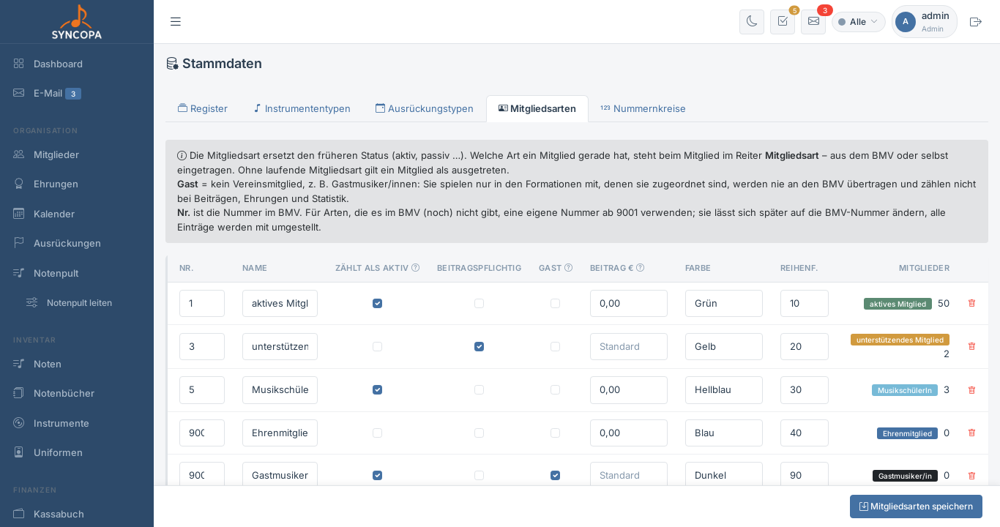

# Stammdaten

**Datei:** `stammdaten.php`  
**Berechtigung:** Nur **Admin**

Stammdaten sind die Grundkonfiguration der Anwendung – Werte die in Dropdowns und Auswahllisten verwendet werden.

---

## Was gehört zu den Stammdaten?

| Bereich | Beispielwerte |
|---|---|
| **Register** | Klarinette, Trompete, Flügelhorn, Posaune, Tuba, Schlagwerk |
| **Instrumententypen** | Trompete B, Klarinette Es, Tuba F, Schlagzeug |
| **Ausrückungstypen** | Probe, Konzert, Fest etc. |
| **Mitgliedsarten** | aktives Mitglied, unterstützendes Mitglied, MusikschülerIn, Ehrenmitglied, Gastmusiker/in |
| **Nummernkreise** | z.B. für Mitglieder, Noten |

---

## Register verwalten

Register sind die musikalischen Gruppen im Verein (z.B. nach Instrumentenfamilien).

1. Navigiere zu **Administration → Stammdaten → Register**
2. Klicke **+ Neues Register**
3. Name eingeben
4. Reihenfolge per Sortierung anpassen
5. **Speichern**

> ⚠️ **Hinweis:** Ein Register kann nur gelöscht werden, wenn ihm **keine Mitglieder** mehr zugeordnet sind.

---

## Instrumententypen verwalten

Instrumententypen definieren die verfügbaren Instrumentgattungen im Inventar.

1. Navigiere zu **Administration → Stammdaten → Instrumententypen**
2. Klicke **+ Neuer Instrumententyp**
3. Name und (Haupt-)Register eingeben
4. **Speichern**

---

## Ausrückungstypen

Kategorien für die Ausrückungen.

> ⚠️ **Hinweis:** Diese sind momentan noch fix im System hinterlegt. Ausrückungstypen Verwaltung folgt...

---

## Nummernkreise

Nummernkreise legen fest, wie automatisch vergebene Nummern für **Mitglieder**, **Noten** und **Instrumente** aussehen (z.B. Mitgliedsnummer, Archivnummer, Inventarnummer).

Für jeden der drei Bereiche kann eingestellt werden:

| Einstellung | Beschreibung |
|---|---|
| Präfix | Text vor der laufenden Nummer, z.B. `M`, `NY` oder `Iy` |
| Stellen (Zahl) | Wie viele Ziffern die laufende Nummer hat, mit führenden Nullen aufgefüllt (1–10 Stellen) |
| Vorschau nächste Nr. | Zeigt live, wie die nächste vergebene Nummer aussehen würde |

Im Präfix können zwei Platzhalter verwendet werden, die automatisch durch das aktuelle Jahr ersetzt werden:

- `Y` → aktuelles Jahr 4-stellig (z.B. `2026`)
- `y` → aktuelles Jahr 2-stellig (z.B. `26`)

**Beispiel:** Präfix `Iy` mit 3 Stellen ergibt im Jahr 2026 die Nummer `I26001`.

1. Navigiere zu **Administration → Stammdaten → Nummernkreise**
2. Präfix und/oder Stellenanzahl je Bereich anpassen (Vorschau aktualisiert sich sofort)
3. **Nummernkreise speichern**

> ⚠️ **Achtung:** Änderungen wirken sich nur auf **neu angelegte** Datensätze aus. Bereits vergebene Nummern (z.B. bestehende Mitgliedsnummern) werden nicht nachträglich geändert.

---

## Mitgliedsarten

**Stammdaten → Mitgliedsarten**

Die Mitgliedsart ersetzt seit Version 2.7.0 den früheren Status (aktiv, passiv …). Sie bestimmt, wer im Verein als **aktiv** gilt, wer **Beitrag** zahlt und wer in Listen erscheint.

Welche Art ein Mitglied gerade hat, steht beim Mitglied im Reiter **Mitgliedsart** – aus dem BMV oder selbst eingetragen, jeweils mit Zeitraum. Es gilt die Art des laufenden Zeitraums. **Ohne laufende Mitgliedsart gilt ein Mitglied als ausgetreten.**

| Spalte | Bedeutung |
|---|---|
| Nr. | Die Nummer im BMV. Für Arten, die es im BMV (noch) nicht gibt, eine eigene Nummer ab **9001** |
| Name | z. B. „aktives Mitglied“ |
| Zählt als aktiv | Mitglieder dieser Art erscheinen bei Proben, Ausrückungen (Anmeldeliste), Instrument- und Uniformausgabe, Festen und in der Statistik |
| Beitragspflichtig | Mitglieder dieser Art bekommen einen Mitgliedsbeitrag |
| Gast | Kein Vereinsmitglied, z. B. Gastmusiker/innen: spielt nur in den Formationen mit, denen er/sie zugeordnet ist, wird nie an den BMV übertragen und zählt nicht bei Beiträgen, Ehrungen und Statistik |
| Beitrag € | Eigener Beitrag für diese Art; leer = Standardbeitrag aus den [Einstellungen](einstellungen.md#mitgliedsbeiträge) |
| Farbe | Farbe des Abzeichens in Listen |
| Reihenf. | Reihenfolge in Auswahllisten |
| Mitglieder | Wie viele Mitglieder diese Art gerade haben |

- Neue Art: in der leeren letzten Zeile eintragen und **Mitgliedsarten speichern**.
- Eine Art, die bei Mitgliedern eingetragen ist, lässt sich nicht löschen.
- Holt Syncopa aus dem BMV eine Art, die es hier noch nicht gibt, wird sie automatisch mit ihrem Namen angelegt.

> 💡 Welche Mitgliedsarten für **Ehrungen** als Mitgliedsjahre zählen, wird unter [Ehrungen → Regeln](ehrungen.md#regeln-nur-administratoren) eingestellt.

---

## Empfohlene Einrichtungsreihenfolge

Bevor Mitglieder und Instrumente angelegt werden, sollten die Stammdaten vollständig konfiguriert sein:

1. ✅ Register anlegen
2. ✅ Instrumententypen anlegen
3. ✅ Mitgliedsarten prüfen: welche zählen als aktiv, welche sind beitragspflichtig (die üblichen sind schon angelegt)
4. ✅ Nummernkreise nach Wunsch anpassen (optional, Standard funktioniert auch ohne Anpassung)
5. ✅ Kleidungsstücke anlegen (→ [Uniformen](uniformen.md))
6. Falls der Verein mehrere Besetzungen führt: → [Formationen](formationen.md) anlegen
7. → Jetzt [Mitglieder](mitglieder.md) anlegen – oder mit aktiver BMV-Anbindung aus dem BMV holen (→ [BMV Daten holen](bmv-daten.md#mitglieder))
