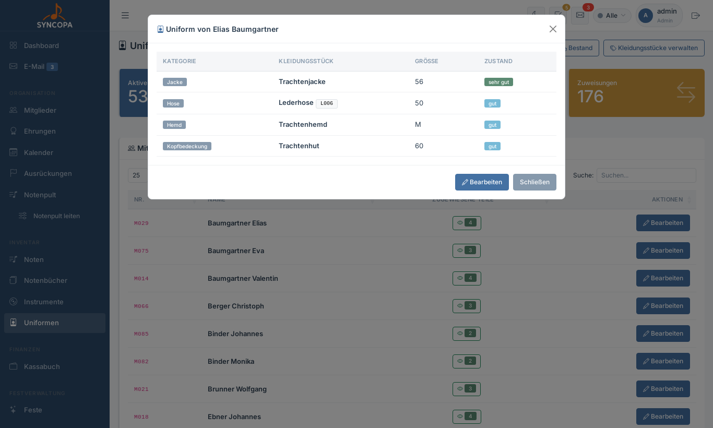
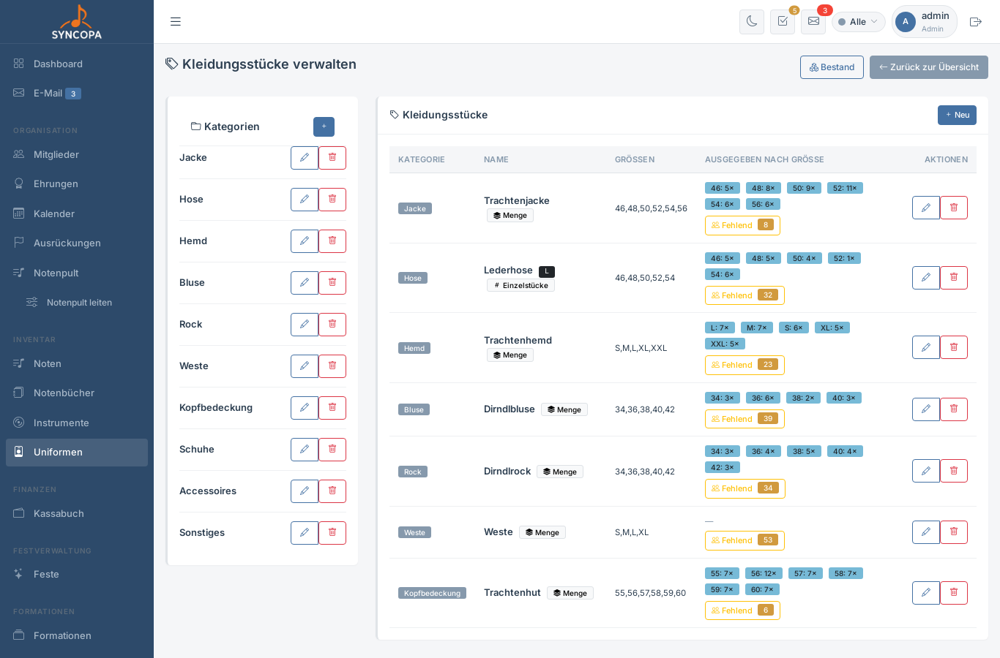
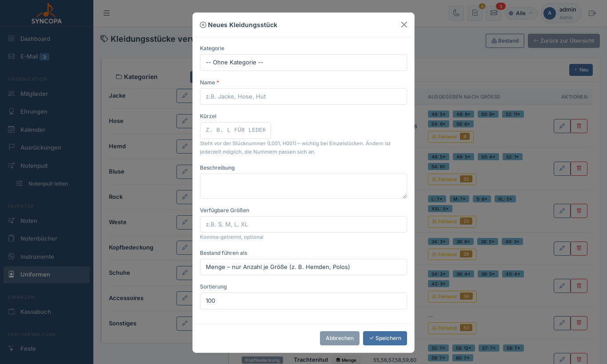
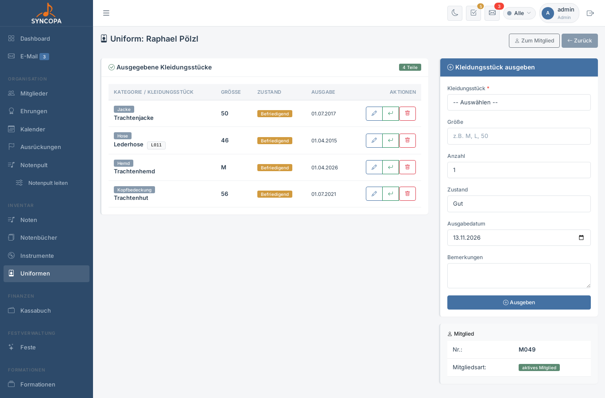

# Uniformen

**Datei:** `uniformen.php`  
**Berechtigung:** `uniformen – lesen`

Die Uniformverwaltung erfasst, welche Kleidungsstücke es im Verein gibt und wer welches Stück gerade trägt bzw. besitzt.



Zusätzlich führt Syncopa den **Bestand**: wie viele Stücke es je Größe gibt, wie viele ausgegeben sind und wie viele im Lager liegen – siehe [Bestand](#bestand).

---

## Struktur der Uniformverwaltung

Syncopa unterscheidet drei Ebenen:

```
Kategorie (z.B. "Ausgehuniform", "Sommerkleidung")
  └── Kleidungsstück (z.B. "Jacke", "Hose", "Hut") – Bestand als Menge oder als Einzelstücke mit Nummer
        └── Zuweisung an ein Mitglied (mit Größe, Zustand, Ausgabedatum, bei Einzelstücken mit Nummer)
```

---

## Übersicht

Die Startseite der Uniformverwaltung zeigt vier Kennzahlen sowie eine Liste aller aktiven Mitglieder:

| Kennzahl | Bedeutung |
|---|---|
| Aktive Mitglieder | Anzahl aktiver Vereinsmitglieder |
| Mit Uniform | Anzahl Mitglieder, denen mindestens ein Kleidungsstück zugewiesen ist |
| Kleidungsstücke | Anzahl angelegter Kleidungsstück-Typen |
| Zuweisungen | Anzahl aller Zuweisungen insgesamt |

In der Mitgliederliste sieht man pro Mitglied, wie viele Kleidungsstücke bereits zugewiesen sind:

1. Klicke auf die grüne Zahl bei **„Zugewiesene Teile"**, um eine Schnellübersicht als Popup zu öffnen
2. Klicke auf **„Bearbeiten"**, um zur vollständigen Uniform-Seite des Mitglieds zu wechseln

---

## Kategorien und Kleidungsstücke verwalten

**Datei:** `uniform_kleidungsstuecke.php`  
**Berechtigung:** `uniformen – schreiben`

Über den Button **„Kleidungsstücke verwalten"** auf der Übersichtsseite gelangt man zur zentralen Verwaltungsseite. Hier werden sowohl die Kategorien (linke Spalte) als auch die eigentlichen Kleidungsstücke (rechte Spalte) gepflegt.



### Kategorie anlegen

1. Klicke links bei **Kategorien** auf **„+"**
2. Name eingeben (z.B. „Festtracht", „Sommertracht", „Regenbekleidung")
3. Optional: Beschreibung und Sortierung (kleinere Zahl = weiter oben)
4. **Speichern**

### Kleidungsstück anlegen

**Datei:** `uniform_kleidungsstuecke.php`



1. Klicke rechts bei **Kleidungsstücke** auf **„+ Neu"**
2. Formular ausfüllen
3. **Speichern**

| Feld | Pflicht | Beschreibung |
|---|---|---|
| Kategorie | – | Übergeordnete Gruppe |
| Name | ✅ | z.B. „Jacke", „Hose", „Hut" |
| Kürzel | – | 1–5 Zeichen, z.B. `L` für Lederhose, `H` für Hut. Steht bei Einzelstücken vor der Nummer (L001, H001), muss unter den Kleidungsstücken eindeutig sein und lässt sich jederzeit ändern – die Nummern passen sich an. |
| Beschreibung | – | Freitext |
| Verfügbare Größen | – | Komma-getrennt, z.B. `S, M, L, XL` |
| Bestand führen als | – | **Menge** (nur Anzahl je Größe, z.B. Hemden, Polos) oder **Einzelstücke mit Nummer** (z.B. Lederhosen, Jacken). Lässt sich nur ändern, solange noch kein Bestand erfasst ist. |
| Sortierung | – | Kleinere Zahl = weiter oben |

Für jedes Kleidungsstück zeigt die Tabelle direkt an, wie viele Zuweisungen es je Größe schon gibt (z.B. „M: 3×, L: 5×") sowie einen Button **„Fehlend"** mit der Anzahl aktiver Mitglieder, die dieses Kleidungsstück noch nicht bekommen haben.

### Mitglieder direkt versorgen

Klickt man bei einem Kleidungsstück auf **„Fehlend“** (bzw. **„Alle versorgt“**), öffnet sich die Liste der aktiven Mitglieder. Oben lässt sich umschalten:

- **Nur ohne** – Mitglieder, die dieses Stück noch nicht haben (Standard bei „Fehlend“)
- **Alle aktiven** – zusätzlich alle, die es schon haben (grün, mit Nummer bzw. Größe, Zustand, Ausgabedatum und Link zum Mitglied) und alle, die es nicht benötigen

In den Zeilen ohne Kleidungsstück kann man:

- **Größe** (mit Lagerstand in Klammern) bzw. bei Einzelstücken das **Stück (Nummer)** wählen – der **Zustand** wird dann vom gewählten Stück übernommen – und mit **„Zuweisen“** sofort ausgeben; die Nummer verschwindet danach aus den anderen Zeilen
- über **„Nicht benötigt“** ein Mitglied markieren, das dieses Kleidungsstück gar nicht braucht (z.B. weil es ein anderes Modell trägt) – es taucht dann unter „Nur ohne“ nicht mehr auf; unter „Alle aktiven“ kann es trotzdem jederzeit ausgegeben werden

> 💡 **Tipp:** Diese Fehlend-Liste ist der schnellste Weg, um vor einem Auftritt zu prüfen, ob wirklich alle Musiker:innen komplett eingekleidet sind.

---

## Uniform einem Mitglied zuweisen

**Datei:** `uniform_mitglied.php`  
**Berechtigung:** `uniformen – schreiben`



1. Öffne in der Übersicht bei einem Mitglied **„Bearbeiten"**
2. Wähle im Kasten **„Kleidungsstück ausgeben"** das gewünschte Kleidungsstück aus. Einzelstücke mit Nummer erscheinen nur, solange die Person noch keines davon hat; Mengen-Kleidungsstücke immer – hat die Person schon welche, steht ein Hinweis („Hat schon 2× in Größe M“) und weitere Stücke werden dazugezählt
3. Trage **Größe**, **Zustand** und **Ausgabedatum** ein – die Größenauswahl zeigt, wie viele Stücke im Lager liegen; ist nichts mehr da, erscheint eine Warnung. Bei Einzelstücken wählst du stattdessen das **Stück (Nummer)** aus dem Lager; Größe und Zustand kommen vom Stück.
4. Optional: Bemerkung ergänzen
5. Klicke **„Ausgeben"**

### Formularfelder

| Feld | Pflicht | Beschreibung |
|---|---|---|
| Kleidungsstück | ✅ | Aus der Liste noch nicht zugewiesener Stücke |
| Stück (Nummer) | – | Nur bei Einzelstücken: Stück aus dem Lager |
| Anzahl | – | Nur bei Mengen-Kleidungsstücken: mehrere Stücke derselben Größe (z.B. 2 Polos). Weitere Stücke gehen nur in derselben Größe. |
| Größe | – | Auswahl aus den verfügbaren Größen mit Lagerstand, sonst Freitext |
| Zustand | – | `sehr gut` · `gut` · `befriedigend` · `schlecht` |
| Ausgabedatum | – | Standard: heutiges Datum |
| Bemerkungen | – | z.B. Besonderheiten zum Stück |

Das zugewiesene Kleidungsstück erscheint danach in der Liste **„Zugewiesene Kleidungsstücke"** auf derselben Seite sowie in der Mitgliederdetailseite unter dem Reiter **Uniform**.

---

## Zuweisung bearbeiten oder zurücknehmen

Auf derselben Seite (`uniform_mitglied.php`) gibt es bei jeder Zeile drei Knöpfe:

| Knopf | Wirkung |
|---|---|
| ✏️ **Bearbeiten** | Größe, Anzahl, Zustand oder Bemerkung ändern (mehr Stück = weitere Ausgabe, weniger = Rückgabe ins Lager). Bei Einzelstücken lässt sich hier auch die **Nummer zuordnen oder tauschen** – das bisherige Stück geht ins Lager zurück. |
| ↩️ **Zurücknehmen** | Fragt, wohin das Stück geht: **Ins Lager** (kann wieder ausgegeben werden, der Lagerstand steigt) oder **Ausscheiden** mit Grund wie verschlissen, verloren, nicht zurückgegeben (zählt nicht mehr zum Bestand). Zustand und Datum lassen sich mit angeben; hat die Person mehrere Stücke, lässt sich auch nur ein Teil zurücknehmen (z.B. 1 von 3). |
| 🗑️ **Löschen** | Nur für Fehleingaben: entfernt den Eintrag ohne Rückgabe-Buchung. |

Kleidungsstücke, die als **„nicht benötigt“** markiert sind, stehen unter der Tabelle und lassen sich dort mit **×** zurücksetzen.

---

## Bestand

**Datei:** `uniform_bestand.php` · erreichbar über **Uniformen → Bestand**  
**Berechtigung:** ansehen `uniformen – lesen`, buchen `uniformen – schreiben`

Die Übersicht zeigt je Kleidungsstück **Bestand**, **ausgegeben** und **im Lager** sowie den Lagerstand je Größe (gelb = 0, rot = negativ). Ein Klick auf **„Bestand“** öffnet die Detailseite mit den Zahlen je Größe und dem **Verlauf** aller Bewegungen (Zugang, Ausgabe, Rückgabe, Ausscheiden, Inventur – mit Datum, Mitglied, Grund und wer gebucht hat).

> **Im Lager = Bestand − ausgegeben.** „Ausgegeben“ ergibt sich automatisch aus den Zuweisungen. Rückgaben ins Lager erhöhen den Lagerstand von selbst, ausgeschiedene Stücke zählen nicht mehr zum Bestand.

### Kleidungsstücke als Menge

| Knopf | Wirkung |
|---|---|
| **Zugang** | Neukauf, Spende, Erstbestand … – Größe, Anzahl, Grund, Datum |
| **Ausscheiden** | Stücke aus dem **Lager** ausscheiden (Grund Pflicht). Stücke, die ein Mitglied noch hat, werden beim Mitglied zurückgenommen und dabei ausgeschieden. |
| **Inventur** | Je Größe eintragen, wie viele Stücke tatsächlich im Lager liegen – Syncopa bucht die Differenz. Leere Felder bleiben unverändert. |

> 💡 **Erstmals erfassen:** Am einfachsten über **Inventur** – nur zählen, was im Lager liegt. Die ausgegebenen Stücke rechnet Syncopa selbst dazu.

### Kleidungsstücke als Einzelstücke mit Nummer

- **Stücke anlegen:** entweder **„Nächste freie Nummern vergeben“** mit Anzahl – Syncopa zählt automatisch weiter – oder **bestimmte Nummern** für schon beschriftete Stücke: eine Nummer („17“ oder „L17“), einen Bereich („1-20“) oder eine Liste („3, 7, 12“)

**Nummern:** immer 3 Zeichen mit dem Kürzel davor – `L001` … `L999`, danach geht es mit `LA00` … `LA99`, `LB00` … bis `LZ99` weiter (zusammen 3.599 Stücke je Kleidungsstück). Jedes Kleidungsstück zählt für sich, es gibt also `L001` und `H001`. Eingaben wie „7“ werden automatisch zu `007`. Nummern ausgeschiedener Stücke werden nicht neu vergeben.
- Die Stückliste zeigt je Nummer Größe, Zustand und ob das Stück **im Lager** ist oder **wer es hat**
- **Ausscheiden** (nur Stücke im Lager) mit Grund; ausgeschiedene Stücke lassen sich über den Schalter einblenden und bei Bedarf **wieder aufnehmen**
- **Löschen** nur für irrtümlich angelegte Stücke, die nie ausgegeben wurden (`uniformen – loeschen`)

Wurde ein Kleidungsstück schon vor der Bestandsführung ausgegeben, zeigt die Seite einen Hinweis „ausgegebene Stücke ohne Nummer“. Lege die Stücke an und ordne beim jeweiligen Mitglied über den Stift die Nummer zu.

---

## Berechtigungen im Überblick

| Aktion | Benötigte Berechtigung |
|---|---|
| Übersicht ansehen | `uniformen – lesen` |
| Kategorien/Kleidungsstücke anlegen und bearbeiten | `uniformen – schreiben` |
| Kleidungsstück ausgeben, bearbeiten, zurücknehmen | `uniformen – schreiben` |
| Bestand ansehen | `uniformen – lesen` |
| Zugang, Ausscheiden, Inventur, Stücke anlegen | `uniformen – schreiben` |
| Kategorie/Kleidungsstück löschen, Fehleingabe löschen, Stück löschen | `uniformen – loeschen` |

> ⚠️ **Achtung:** Eine Kategorie kann nur gelöscht werden, solange ihr keine Kleidungsstücke mehr zugeordnet sind.
